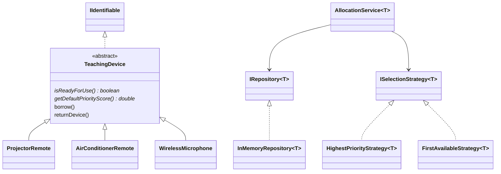

# OOP_LAB7

Cài đặt Java, kiểm thử trực tiếp trong `Main`, không cần thư viện ngoài.

## Thiết kế



- `TeachingDevice` giữ thông tin chung và xử lý mượn/trả; ba lớp con ghi đè kiểm tra sẵn sàng và tính điểm (đa hình thứ nhất).
- `ISelectionStrategy<T>` cho phép đổi thuật toán chọn khi chạy (đa hình thứ hai).
- `IRepository<T>` và `InMemoryRepository<T>` dùng `T extends IIdentifiable` để đọc mã an toàn kiểu, không cần tạo kho riêng cho từng loại.
- `AllocationService<T extends TeachingDevice>` có thể gọi hành vi thiết bị; chiến lược chỉ cần `T` vì hàm tính điểm được truyền vào. Không cần generic cho các lớp thiết bị cụ thể.
- Dùng `LinkedHashMap`: tìm theo mã trung bình O(1), giữ thứ tự thêm cho chiến lược chọn đầu tiên; đổi lại tốn bộ nhớ hơn `List`.
- Điều hòa được lọc tương thích phòng trước khi chọn; điểm mặc định là 100 khi có phòng tương thích, 0 khi tập phòng rỗng vì phương thức tính điểm không nhận phòng.
- `returnDevice()` thay cho `Return()` vì `return` là từ khóa Java. Trả khi chưa mượn gây `IllegalStateException`.

## Chạy

```powershell
javac -encoding UTF-8 -d out src/*.java
java -cp out Main
```
